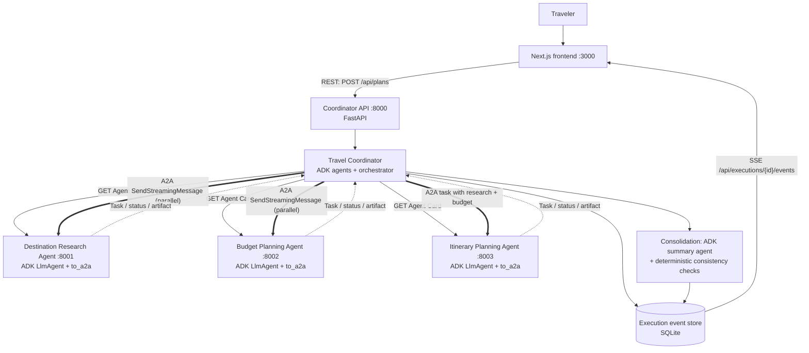

# AI Travel Planner — Google ADK + Gemini + A2A

A working travel planner built from **four independently running AI agents** that discover each other through **A2A Agent Cards** and collaborate over the **Agent2Agent (A2A) protocol**. Every agent is a **Google Agent Development Kit (ADK)** agent powered by **Gemini**. A live dashboard shows each agent's state, every A2A message on the wire, and the final itinerary and budget.

> Ask for *"a 3-day trip to Cebu with a ₱10,000 budget — beaches, adventure, local food"* and watch the Coordinator discover three specialist services, run two of them **in parallel over the network**, pass their results to a third, and consolidate one validated plan.

There are no simulated agents. Each specialist is its own HTTP server with its own Agent Card. The Coordinator talks to them only through the official `a2a-sdk` client, and everything the dashboard shows comes from those protocol events.

---

## Contents

1. [Features](#features) · 2. [Tech stack](#technology-stack) · 3. [Architecture](#architecture) · 4. [Google ADK](#google-adk-in-this-project) · 5. [A2A](#a2a-in-this-project) · 6. [The agents](#the-agents) · 7. [Project structure](#project-structure)
8. [Installation](#installation) · 9. [Configuration reference](#configuration-reference) · 10. [Run](#running-the-system) · 11. [Endpoints](#endpoints) · 12. [Testing A2A by hand](#testing-a2a-communication-by-hand)
13. [Example requests](#example-requests) · 14. [Visualization guide](#agent-visualization-guide) · 15. [Live demo](#live-demo) · 16. [Automated tests](#automated-tests) · 17. [Troubleshooting](#troubleshooting) · 18. [Future improvements](#future-improvements)

Deeper docs: [Architecture](docs/ARCHITECTURE.md) · [A2A communication](docs/A2A-COMMUNICATION.md) · [Agent guide](docs/AGENT-GUIDE.md) · [Event flow](docs/EVENT-FLOW.md) · [Demo guide](docs/DEMO-GUIDE.md)

---

## Features

- **Four ADK agents.** One Travel Coordinator and three specialists (Destination Research, Budget Planning, Itinerary Planning). All of them use Gemini with structured (Pydantic) output contracts.
- **Real A2A services.** Each specialist runs on its own port and serves `/.well-known/agent-card.json`. It speaks JSON-RPC A2A with streaming.
- **Discovery before delegation.** The Coordinator fetches and validates each Agent Card (required skill, streaming, JSON-RPC interface) before it sends any work.
- **Parallel plus dependent orchestration.** Destination and Budget run concurrently. Itinerary then receives both results in its A2A task.
- **Full task lifecycle.** The Coordinator tracks task IDs through `SUBMITTED → WORKING → artifact → COMPLETED`. It also handles failed tasks, timeouts (with cancellation), retries, and artifact validation.
- **Exact numbers.** Gemini estimates the line items, then code computes every total, the contingency, the remaining budget and any overrun.
- **Live visualization.** Agent cards with 9 states, an animated SVG communication graph, an execution timeline, and an A2A inspector showing sanitized JSON payloads.
- **Durable event stream.** SSE backed by SQLite, with per-execution access tokens, reconnection via `Last-Event-ID`, page-reload recovery, and final-result retrieval that doesn't depend on the stream.
- **Plan refinement.** "Make the trip cheaper" and similar requests go to a Coordinator ADK agent. It decides which specialists to re-invoke over A2A and reuses the rest of the plan.

## Technology stack

| Layer | Technology |
|---|---|
| Agents | [Google ADK](https://adk.dev) `google-adk` 2.15 (`LlmAgent`, `Runner`, `to_a2a`) |
| Model | Gemini (`gemini-3.5-flash` by default) through `google-genai`, via the Gemini API or Vertex AI |
| Agent protocol | [A2A](https://a2a-protocol.org/latest/) through the official [`a2a-sdk`](https://github.com/a2aproject/a2a-python) 1.3 (protocol 1.0, JSON-RPC binding) |
| Coordinator API | FastAPI, `sse-starlette`, SQLite event store, httpx |
| Frontend | Next.js 16 (App Router), React 19, Tailwind CSS 4, hand-built SVG graph |
| Tooling | `uv`, `pnpm`, pytest, ruff, mypy, Vitest + Testing Library, ESLint |

## Architecture



The specialists never call each other directly. The dependency "Itinerary needs Destination + Budget" is resolved by the Coordinator, which forwards both validated results inside the Itinerary agent's A2A task. Details: [docs/ARCHITECTURE.md](docs/ARCHITECTURE.md).

## Google ADK in this project

[Google ADK](https://adk.dev) ([docs](https://google.github.io/adk-docs/), [repo](https://github.com/google/adk-python), [samples](https://github.com/google/adk-samples)) is Google's framework for building agents. This project uses:

- **`LlmAgent`** for all five agent definitions (three specialists plus the Coordinator's summary and refinement-router agents). Each has an instruction, a Gemini model, and an `output_schema` (Pydantic) so Gemini returns JSON in a fixed shape.
- **Callbacks.**
  - `after_model_callback` validates the model's JSON against the contract and applies deterministic post-processing (budget arithmetic, itinerary ordering) *inside the agent*.
  - `before_agent_callback` and `after_agent_callback` log each invocation and its duration.
- **`to_a2a()`** (`google.adk.a2a.utils.agent_to_a2a`) turns each specialist into an A2A Starlette app. ADK's `A2aAgentExecutor` converts A2A requests into ADK runs and ADK events back into A2A task updates.
- **`InMemoryRunner`** runs the Coordinator's own agents in-process.

## A2A in this project

[A2A](https://a2a-protocol.org/latest/) is an open protocol that lets independently built agents discover each other and exchange tasks. Here:

- Each specialist publishes an **Agent Card** (name, description, version, skills, capabilities, I/O modes, and a `supportedInterfaces` entry with URL, `JSONRPC` binding and protocol version `1.0`).
- The Coordinator resolves cards with `A2ACardResolver`, builds clients with `ClientFactory`, and sends **`SendStreamingMessage`** requests. It consumes the stream of `Task`, `TaskStatusUpdateEvent` and `TaskArtifactUpdateEvent` responses.
- The result of each task is a **JSON artifact** that the Coordinator validates against a Pydantic schema before using it.

Message-by-message walkthrough: [docs/A2A-COMMUNICATION.md](docs/A2A-COMMUNICATION.md).

## The agents

| Agent | Runs as | Responsibility | Output contract |
|---|---|---|---|
| **Travel Coordinator** | FastAPI app on `:8000` (A2A *client*) | Validates input, discovers agents, delegates in parallel then sequentially, tracks tasks, retries, validates and cross-checks results, consolidates the plan, routes refinements | `TravelPlan`, built from `CoordinatorSummary` and `RefinementDecision` |
| **Destination Research** | A2A server on `:8001` | Categorized attractions with descriptions, area, visit duration, best time, per-person cost and rationale; local food; getting around | `DestinationResearch` |
| **Budget Planning** | A2A server on `:8002` | Line items for transportation, accommodation, food, activities and miscellaneous; contingency; exact totals, remaining budget, overrun, cost-saving tips | `BudgetPlan` |
| **Itinerary Planning** | A2A server on `:8003` | Day-by-day morning, afternoon and evening schedule grouped by area, with transport notes, daily costs and practical notes | `ItineraryPlan` |

Prompts, contracts and how to add an agent: [docs/AGENT-GUIDE.md](docs/AGENT-GUIDE.md). All prices are labelled as AI-generated estimates.

## Project structure

```text
.
├── app/                         Next.js App Router (layout, page, global design tokens)
├── components/
│   ├── app/PlannerApp.tsx       Page shell wiring everything together
│   ├── planner/                 Trip request form
│   ├── agents/                  Agent cards + status badges
│   ├── agent-graph/             Interactive SVG communication graph
│   ├── activity-timeline/       Live execution timeline
│   ├── communication-inspector/ A2A message inspector
│   ├── plan/ itinerary/ budget/ Final plan, itinerary, budget breakdown, refinement
│   └── ui/                      Small shared primitives
├── hooks/                       useExecution (SSE + recovery), useAgents (discovery polling), useNow
├── lib/                         types.ts (contract mirror), api.ts, agent-state.ts, format.ts, status.ts
├── __tests__/                   Frontend tests (Vitest + Testing Library)
├── backend/
│   ├── pyproject.toml           Python deps (uv) + ruff/mypy/pytest config
│   ├── shared/                  config, schemas, events, logging, exceptions, A2A server + agent helpers
│   ├── agents/
│   │   ├── destination/         prompts.py · agent.py · server.py
│   │   ├── budget/              prompts.py · agent.py · calculations.py · server.py
│   │   └── itinerary/           prompts.py · agent.py · scheduling.py · server.py
│   ├── coordinator/             main.py (API) · orchestrator.py · discovery.py · a2a_client.py
│   │                            agent.py + prompts.py (coordinator ADK agents) · consistency.py · event_store.py
│   ├── tools/send_a2a_task.py   CLI that sends a raw A2A task to one specialist
│   └── tests/                   unit, event store, A2A integration and end-to-end tests
├── scripts/dev.sh               All-in-one launcher
├── scripts/check-agents.sh      Health + Agent Card summary
├── docs/                        Architecture, A2A, agents, events, demo guide
└── .env.example
```

## Installation

Follow these steps in order. They work on macOS and Linux. On Windows, use [WSL](https://learn.microsoft.com/windows/wsl/install), because the helper scripts are Bash.

### Step 1: Install the prerequisites

| Tool | Version | Why | Install |
|---|---|---|---|
| Python | **3.11+** (developed on 3.13) | Required by `google-adk` | Optional: `uv` downloads a suitable Python automatically if none is found |
| [uv](https://docs.astral.sh/uv/) | recent | Creates `backend/.venv` and installs the Python dependencies | `curl -LsSf https://astral.sh/uv/install.sh \| sh` or `brew install uv` |
| Node.js | **20.9+** (developed on 24) | Required by Next.js 16 | [nodejs.org](https://nodejs.org/) or `nvm install 24` |
| pnpm | 11 | Frontend package manager (the repo pins `pnpm@11.5.0`) | `npm install -g pnpm` |
| Google Cloud CLI | recent | **Only for Vertex AI** (Option B below) | [Install gcloud](https://cloud.google.com/sdk/docs/install) |

Check them:

```bash
uv --version && node --version && pnpm --version
```

### Step 2: Get the code

```bash
git clone <your-repo-url> devfest-demo-cdo
cd devfest-demo-cdo
```

Every command below runs from this repository root unless it says `cd backend`.

### Step 3: Install dependencies

```bash
# Backend: creates backend/.venv and installs google-adk, a2a-sdk, FastAPI, ...
cd backend && uv sync && cd ..

# Frontend: installs Next.js, React, Tailwind, Vitest, ...
pnpm install
```

`./scripts/dev.sh` also runs `uv sync` on every start, and `pnpm install` if `node_modules` is missing. Step 3 just surfaces install problems early.

### Step 4: Gemini setup (`.env`)

Create your local configuration file from the template:

```bash
cp .env.example .env
```

> **Edit `.env`, not `.env.example`.** The services only read `.env`, which is git-ignored. `.env.example` is the committed template and must never contain real values.

Then choose **one** of these two options.

**Option A: Gemini API key (simplest).** Create a key at [Google AI Studio](https://aistudio.google.com/apikey) and set in `.env`:

```bash
GOOGLE_API_KEY=your-key
GOOGLE_GENAI_USE_VERTEXAI=FALSE
```

**Option B: Vertex AI (Google Cloud project, no API key).** Run these once:

```bash
gcloud auth application-default login                              # sign in for local apps
gcloud config set project your-project-id
gcloud auth application-default set-quota-project your-project-id
gcloud services enable aiplatform.googleapis.com                   # enable the Vertex AI API
```

Then set in `.env`:

```bash
GOOGLE_API_KEY=
GOOGLE_GENAI_USE_VERTEXAI=TRUE
GOOGLE_CLOUD_PROJECT=your-project-id
GOOGLE_CLOUD_LOCATION=us-central1
```

For Vertex AI, the project needs billing enabled and your account needs the **Vertex AI User** role (`roles/aiplatform.user`); project owners already have it. If the model is not available in your region, try `GOOGLE_CLOUD_LOCATION=global` or another region.

Both options use `GEMINI_MODEL` (default `gemini-3.5-flash`). Every service checks the Gemini settings at startup and exits with a message naming the missing variable. Wrong credentials or permissions, however, only show up on the first Gemini call, so run one plan to confirm (Step 5). See the [Gemini API docs](https://ai.google.dev/gemini-api/docs) and the [Vertex AI docs](https://cloud.google.com/vertex-ai/generative-ai/docs).

### Step 5: Start and verify

```bash
./scripts/dev.sh                 # starts the 3 agents, the coordinator and the frontend
```

In a second terminal:

```bash
./scripts/check-agents.sh        # all four services UP, gemini_configured=True
```

Open **http://localhost:3000**. All four agent cards should show **Available**. Click **Load demo scenario**, then **Plan my trip with the agents**. A completed plan confirms that your Gemini credentials work end to end. If an agent fails, its log lines in the `dev.sh` terminal show the real error (see [Troubleshooting](#troubleshooting)).

**Port 3000 already in use?** Another app is using it. Stop that app, or run the frontend on another port:

1. Add `CORS_ORIGINS=http://localhost:3100` to `.env`.
2. Run `./scripts/dev.sh --no-frontend`.
3. Run `pnpm dev -p 3100` in another terminal.

**Optional: run the test suites** (no Gemini credentials needed):

```bash
pnpm test:backend   # 60 backend tests
pnpm test           # 39 frontend tests
```

## Configuration reference

The Python services read `.env` from the repo root (and `backend/.env` if present). Next.js reads the same file but exposes only `NEXT_PUBLIC_*` variables to the browser, so **no secret ever reaches the frontend**. Only the Gemini settings from [Step 4](#step-4-gemini-setup-env) are required; everything else has a working default.

| Variable | Default | Used by | Purpose |
|---|---|---|---|
| `GOOGLE_API_KEY` | — | all agents | Gemini API key (Option A) |
| `GOOGLE_GENAI_USE_VERTEXAI` | `FALSE` | all agents | `TRUE` to use Vertex AI |
| `GOOGLE_CLOUD_PROJECT` / `GOOGLE_CLOUD_LOCATION` | — | all agents | Vertex AI project and region (Option B) |
| `GEMINI_MODEL` | `gemini-3.5-flash` | all agents | Model name |
| `AGENT_HOST` | `127.0.0.1` | all services | Bind interface |
| `AGENT_PUBLIC_HOST` | `localhost` | specialists, coordinator | Host advertised in Agent Cards and default URLs |
| `COORDINATOR_PORT` | `8000` | coordinator | API port |
| `DESTINATION_AGENT_PORT` / `BUDGET_AGENT_PORT` / `ITINERARY_AGENT_PORT` | `8001` / `8002` / `8003` | specialists | Service ports |
| `DESTINATION_AGENT_URL` / `BUDGET_AGENT_URL` / `ITINERARY_AGENT_URL` | `http://{AGENT_PUBLIC_HOST}:{port}` | coordinator, specialists | Where specialists are discovered (and the URL each advertises in its card) |
| `A2A_TIMEOUT_SECONDS` | `180` | coordinator | Timeout per remote task attempt (the task is cancelled on timeout) |
| `A2A_MAX_RETRIES` | `1` | coordinator | Retries after a failed, timed-out or invalid task |
| `DISCOVERY_TIMEOUT_SECONDS` | `5` | coordinator | Agent Card fetch timeout |
| `MAX_CONCURRENT_EXECUTIONS` | `4` | coordinator | Running plans allowed at once (more returns HTTP 429) |
| `CORS_ORIGINS` | `http://localhost:3000,http://127.0.0.1:3000` | coordinator | Allowed browser origins |
| `COORDINATOR_DB_PATH` | `backend/.data/coordinator.db` | coordinator | SQLite event store |
| `LOG_LEVEL` | `INFO` | all services | Python log level |
| `NEXT_PUBLIC_COORDINATOR_URL` | `http://localhost:8000` | frontend | Coordinator URL used by the browser (inlined at build time) |

## Running the system

### All-in-one

```bash
./scripts/dev.sh                 # 3 agents + coordinator + frontend  (or: pnpm dev:all)
./scripts/dev.sh --no-frontend   # backend services only              (or: pnpm dev:backend)
```

The script checks for `uv`, `pnpm` and `.env`, refuses to start if a port is busy, syncs dependencies, starts the agents and waits for their Agent Cards. Then it starts the Coordinator and the frontend, and prefixes each log line with the service name. Press Ctrl-C to stop everything. Open **http://localhost:3000**.

### Starting services individually

Run each command in its own terminal, from `backend/`:

```bash
uv run python -m agents.destination.server   # :8001
uv run python -m agents.budget.server        # :8002
uv run python -m agents.itinerary.server     # :8003
uv run python -m coordinator.main            # :8000  (start after the agents, or it reports them offline)
```

Then the frontend, from the repo root:

```bash
pnpm dev                                     # :3000
```

Each specialist runs on its own, so you can start one and inspect it without the rest of the system:

```bash
cd backend && uv run python -m agents.budget.server
curl -s http://localhost:8002/.well-known/agent-card.json | python3 -m json.tool
```

## Endpoints

**Specialists** (`:8001`, `:8002`, `:8003`)

| Method | Path | Description |
|---|---|---|
| GET | `/.well-known/agent-card.json` | A2A Agent Card |
| POST | `/` | A2A JSON-RPC endpoint (`SendMessage`, `SendStreamingMessage`, `GetTask`, `CancelTask`, …) |
| GET | `/health` | `{"status":"ok","agent_id":…,"name":…,"agent_card":…}` |

**Coordinator** (`:8000`; interactive docs at `/docs`)

| Method | Path | Description |
|---|---|---|
| GET | `/health` | Status, model, `gemini_configured`, specialist URLs |
| GET | `/api/agents` | Live discovery of all specialists: card, skills, latency, availability |
| POST | `/api/plans` | Start a plan (body: trip request) → `202 {execution_id, access_token}` |
| GET | `/api/executions/{id}?token=` | Snapshot: status, every event, final `result` |
| GET | `/api/executions/{id}/events?token=[&last_event_id=]` | SSE stream (also honours the `Last-Event-ID` header) |
| POST | `/api/executions/{id}/refine?token=` | Refine a completed plan (body `{"instruction": "…"}`) → new execution |

Check everything at once with `./scripts/check-agents.sh`.

## Testing A2A communication by hand

**1. Inspect the Agent Cards**

```bash
./scripts/check-agents.sh
```

**2. Send a real A2A task straight to one specialist (no Coordinator involved).** The CLI resolves the card, opens a streaming task, and prints every protocol event and the artifact:

```bash
cd backend
uv run python -m tools.send_a2a_task destination
uv run python -m tools.send_a2a_task budget --full
uv run python -m tools.send_a2a_task itinerary     # gets inputs from destination + budget first
```

Example output (shape):

```text
== Agent Card: Budget Planning Agent v1.0.0 (4 ms)
   endpoint : http://localhost:8002/  [JSONRPC]
-> SendStreamingMessage to budget (412 bytes)
<-   0.01s Task                     id=859a7244-… state=TASK_STATE_SUBMITTED
<-   0.01s TaskStatusUpdateEvent    state=TASK_STATE_WORKING
<-   6.80s TaskStatusUpdateEvent    state=TASK_STATE_WORKING (+message)
<-   6.81s TaskArtifactUpdateEvent  artifact=… (2,315 chars)
<-   6.81s TaskStatusUpdateEvent    state=TASK_STATE_COMPLETED
```

**3. Raw JSON-RPC with curl** (non-streaming `SendMessage`, A2A protocol 1.0):

```bash
curl -s http://localhost:8001/ -H 'Content-Type: application/json' -H 'A2A-Version: 1.0' -d '{
  "jsonrpc": "2.0", "id": 1, "method": "SendMessage",
  "params": {"message": {"messageId": "m1", "role": "ROLE_USER",
    "parts": [{"text": "{\"request\": {\"destination\": \"Cebu\", \"days\": 2, \"budget\": 8000, \"currency\": \"PHP\"}}"}]}}
}' | python3 -m json.tool
```

## Example requests

```bash
# Start a plan
curl -s -X POST http://localhost:8000/api/plans -H 'Content-Type: application/json' -d '{
  "destination": "Cebu, Philippines", "origin": "Manila", "days": 3, "travelers": 1,
  "budget": 10000, "currency": "PHP", "interests": ["beaches", "adventure", "local food"],
  "travel_style": "budget"
}'
# -> {"execution_id":"…","access_token":"…"}

# Watch the live event stream
curl -N "http://localhost:8000/api/executions/<execution_id>/events?token=<access_token>"

# Fetch the final plan (works any time after completion)
curl -s "http://localhost:8000/api/executions/<execution_id>?token=<access_token>" | python3 -m json.tool

# Refine it
curl -s -X POST "http://localhost:8000/api/executions/<execution_id>/refine?token=<access_token>" \
  -H 'Content-Type: application/json' -d '{"instruction": "Make the trip cheaper"}'
```

Trip request fields: `destination` (required), `origin`, `start_date` / `end_date` (`YYYY-MM-DD`; if both are given they set `days`), `days` (1–14), `travelers` (1–20), `budget` (> 0, whole group), `currency` (3-letter code, default `PHP`), `interests` (list), `travel_style` (`budget` | `balanced` | `comfort` | `luxury`), `preferences` (free text).

## Agent visualization guide

| Panel | What it shows | Driven by |
|---|---|---|
| **Agent cards** | Name, description, service URL, availability, status (9 states), current task, task ID, live duration, latest activity, output summary. "Show execution details" expands skills, the Agent Card JSON and that agent's events | `/api/agents` + SSE events |
| **Communication graph** | Coordinator plus three specialists. Solid edges are A2A channels; dashed edges are data dependencies into the Itinerary agent. A pulse travels along an edge **only when** a real A2A request, response or artifact event arrives. Edges colour on completion or failure. Click a node to filter the inspector | `channel: "a2a"` events |
| **Execution timeline** | Every event in order, with clock time, offset from start, agent, and an `A2A` / `INTERNAL` badge | all events |
| **A2A inspector** | Protocol messages (source → target, message type, task ID, task state). The detail pane shows request and response summaries, artifacts and sanitized JSON. "Include internal events" adds orchestration steps, clearly labelled | `channel: "a2a"` events (+ internal on demand) |
| **Travel plan** | Overview, daily itinerary, recommendations (with Wikipedia images where available), budget breakdown, travel tips, consistency notes, refinement panel | snapshot `result` |

**Status legend:** Offline · Discovering · Available · Pending (task submitted) · Running (remote task `WORKING`) · Communicating (result in flight) · Completed · Failed · Retrying. Event semantics: [docs/EVENT-FLOW.md](docs/EVENT-FLOW.md).

## Live demo

1. `./scripts/dev.sh`, then open http://localhost:3000 and confirm all four agent cards say **Available**.
2. Click **Load demo scenario** (3-day Cebu, ₱10,000, beaches, adventure, local food), then **Plan my trip with the agents**.
3. Narrate: discovery, then the Destination and Budget agents working in parallel, then Itinerary receiving both, then consolidation. Open an A2A message in the inspector.
4. Refine with **Make the trip cheaper** and point out that only the agents that needed to re-run were invoked.

The full 3–5 minute script, with what to point at during each stage, is in [docs/DEMO-GUIDE.md](docs/DEMO-GUIDE.md).

## Automated tests

```bash
cd backend
uv run pytest              # 60 tests: unit, schema compatibility, event store, A2A integration, end-to-end
uv run ruff check . && uv run mypy .

cd ..
pnpm test                  # 39 frontend tests (Vitest + Testing Library)
pnpm lint && pnpm typecheck && pnpm build
```

The automated backend tests replace **only Gemini** with a deterministic fake `BaseLlm` (`backend/tests/fakes.py`). Everything else is the real implementation: ADK runners, `to_a2a` servers on real ports, the `a2a-sdk` client, HTTP, SSE and SQLite. This covers Agent Card discovery, task IDs and lifecycle, artifacts, failed tasks on the wire plus retry, timeouts plus cancellation, offline agents, parallel-then-dependent ordering, reconnection, token isolation, CORS and refinement. **The fake is never used by the application.** Running against live Gemini needs `GOOGLE_API_KEY`; see [Known limitations](docs/ARCHITECTURE.md#known-limitations).

## Troubleshooting

| Symptom | Cause and fix |
|---|---|
| Service exits: `GOOGLE_API_KEY is not set` | Copy `.env.example` to `.env` and set the key (or configure Vertex AI) |
| Vertex AI: agent fails with `PERMISSION_DENIED`, `403` or *could not find default credentials* | Run `gcloud auth application-default login`, enable `aiplatform.googleapis.com`, check billing and the Vertex AI User role ([Step 4](#step-4-gemini-setup-env)) |
| Vertex AI: *model not found* (`404`) | The model isn't available in `GOOGLE_CLOUD_LOCATION`. Try `global` or another region, or change `GEMINI_MODEL` |
| Settings seem ignored | You edited `.env.example`; the services read `.env` |
| Frontend banner: *coordinator is not reachable* | Start the backend (`./scripts/dev.sh --no-frontend`). If the coordinator runs elsewhere, set `NEXT_PUBLIC_COORDINATOR_URL` and rebuild |
| Banner: *Gemini is not configured* (HTTP 503) | The coordinator started without credentials. Fix `.env` and restart it |
| An agent card shows **Offline** | That specialist isn't running or its URL is wrong. Run `./scripts/check-agents.sh` |
| Execution fails with `remote task ended in TASK_STATE_FAILED` | The specialist's Gemini call failed. Its terminal shows the real error (invalid key, quota, unknown model name). The A2A message is deliberately sanitized |
| `port 8000 is already in use` | Another instance is running, or another app holds the port. Stop it, or change `*_PORT` in `.env` (and `CORS_ORIGINS` if you change the frontend port) |
| Browser console shows CORS errors | Add your frontend origin to `CORS_ORIGINS` |
| Tasks time out | Raise `A2A_TIMEOUT_SECONDS`; long itineraries on slower models can take more than 60 s |
| HTTP 429 | `MAX_CONCURRENT_EXECUTIONS` plans are already running |
| Old executions show *Interrupted* | The coordinator restarted mid-run. Those executions are marked failed on startup by design |

## Future improvements

- Ground prices with live sources (flights, hotels, Google Places) through ADK tools, and drop the "estimate" caveat where verified.
- Push the specialists' internal ADK progress (e.g. tool calls) as intermediate A2A status messages.
- Authenticated Agent Cards and A2A security schemes; signed cards.
- Deploy each agent to Cloud Run or Vertex AI Agent Engine and discover them through a registry.
- Persist A2A task stores (`DatabaseTaskStore`) so specialists survive restarts.
- Playwright end-to-end tests in CI with a recorded Gemini fixture.

## References

[ADK](https://adk.dev) · [ADK docs](https://google.github.io/adk-docs/) · [adk-python](https://github.com/google/adk-python) · [adk-samples](https://github.com/google/adk-samples) · [A2A protocol](https://a2a-protocol.org/latest/) · [a2a-python](https://github.com/a2aproject/a2a-python) · [Gemini API](https://ai.google.dev/gemini-api/docs) · [Google AI Studio](https://aistudio.google.com/)
