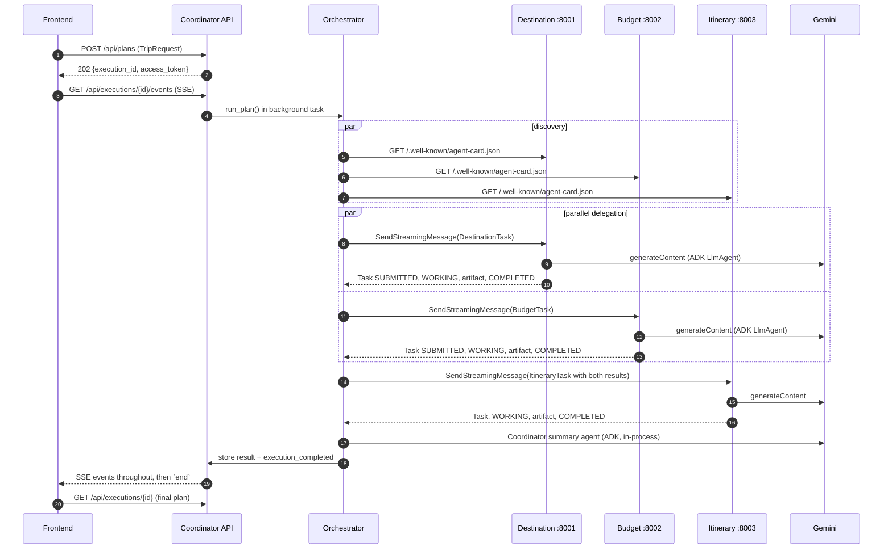

# Architecture

This document explains how the AI Travel Planner is put together and why. The primary references are [adk.dev](https://adk.dev), the [ADK docs](https://google.github.io/adk-docs/), the [A2A specification](https://a2a-protocol.org/latest/) and the [a2a-python SDK](https://github.com/a2aproject/a2a-python).

## Processes

| Process | Port | Code | Role |
|---|---|---|---|
| Destination Research Agent | 8001 | `backend/agents/destination/` | A2A **server** wrapping an ADK `LlmAgent` |
| Budget Planning Agent | 8002 | `backend/agents/budget/` | A2A **server** wrapping an ADK `LlmAgent` |
| Itinerary Planning Agent | 8003 | `backend/agents/itinerary/` | A2A **server** wrapping an ADK `LlmAgent` |
| Travel Coordinator | 8000 | `backend/coordinator/` | FastAPI API + orchestrator + A2A **client** + its own ADK agents |
| Frontend | 3000 | `app/`, `components/`, `hooks/`, `lib/` | Next.js dashboard; talks only to the Coordinator |

Each specialist is a separate OS process with its own ADK `Runner`, session service and A2A task store, so no state is shared between them. They can run on different machines: point `*_AGENT_URL` at them.



## Backend layout

```text
backend/
├── shared/
│   ├── config.py          Settings (pydantic-settings) + Gemini validation
│   ├── schemas.py         All data contracts (input, agent outputs, final plan)
│   ├── events.py          ExecutionEvent contract + payload sanitizer
│   ├── agent_runtime.py   JSON parsing, the validating after_model_callback, logging callbacks
│   ├── a2a_server.py      Agent Card builder, to_a2a app factory, /health, uvicorn runner
│   ├── logging.py         Log format
│   └── exceptions.py      User-presentable error hierarchy
├── agents/<name>/
│   ├── prompts.py         Instruction + Agent Card metadata (AgentSpec)
│   ├── agent.py           build_agent(model) -> LlmAgent
│   ├── server.py          create_app() + `python -m agents.<name>.server`
│   └── calculations.py / scheduling.py   deterministic post-processing (budget / itinerary)
└── coordinator/
    ├── main.py            FastAPI app factory, REST + SSE routes
    ├── orchestrator.py    Plan and refinement flows
    ├── discovery.py       Agent Card resolution + validation
    ├── a2a_client.py      RemoteAgentCaller: streaming tasks, lifecycle events, retries, timeouts
    ├── agent.py           Coordinator ADK agents (summary, refinement router) + run_structured()
    ├── prompts.py         Their instructions
    ├── consistency.py     Cross-agent consistency checks
    └── event_store.py     SQLite execution/event store + live notification
```

Prompts live in `prompts.py`, separate from execution logic. Contracts live in one place (`shared/schemas.py`) and are mirrored for the browser in `lib/types.ts`.

## Key design decisions

| Decision | Why | Reference |
|---|---|---|
| Serve specialists with ADK's `to_a2a()` | It is ADK's officially supported A2A bridge: `A2aAgentExecutor` maps A2A requests to ADK runs and ADK events to A2A task updates, so we don't hand-roll the protocol | [ADK A2A docs](https://google.github.io/adk-docs/a2a/), `google.adk.a2a.utils.agent_to_a2a` |
| Hand-written Agent Cards (`shared/a2a_server.py`) | Descriptive skills, examples and JSON I/O modes; the auto-generated card only knows the agent's name and description | [A2A Agent Card spec](https://a2a-protocol.org/latest/specification/) |
| Coordinator uses the `a2a-sdk` client directly instead of `RemoteA2aAgent` | The dashboard must show *every* protocol message (Task, status, artifact, task IDs, failures). The raw `Client.send_message` stream exposes all of them; we mirror each one into an event | [a2a-python](https://github.com/a2aproject/a2a-python) |
| Orchestration in Python, not LLM transfer | Deterministic, testable control flow: parallel Destination + Budget, then the dependent Itinerary. Gemini decides *content*, code decides *order* | — |
| The Coordinator is still an ADK app | `LlmAgent`s with `InMemoryRunner` write the consolidated summary and decide which agents a refinement needs | [ADK Runner](https://google.github.io/adk-docs/runtime/) |
| `output_schema` plus a validating `after_model_callback` | Gemini is constrained to JSON. The callback validates it and computes exact arithmetic before the artifact leaves the agent, and malformed output fails the A2A task, which the Coordinator retries | [ADK LlmAgent](https://google.github.io/adk-docs/agents/llm-agents/) |
| SSE (not WebSockets) | Updates flow one way (server to browser); native `EventSource` reconnection and `Last-Event-ID` | — |
| SQLite event store with per-execution `seq` | Ordering, durability, reconnection replay, final-result retrieval after the stream ends, recovery after restarts. No shared in-memory lists | — |
| Per-execution random access token (SHA-256 stored) | Isolates sessions without a user system; `EventSource` cannot set headers, so the token goes in the query string | — |

### Versions

`google-adk` 2.15.0 declares `a2a-sdk >=0.3.4,<2` for its `a2a` extra, and this project pins `a2a-sdk >=1.3,<2` (1.3.1 installed). ADK's internal `_compat` module selects the 1.x code path, so the two are compatible. The A2A wire protocol version is **1.0** (`A2A-Version: 1.0` header; JSON-RPC binding). Everything was verified against the installed sources, not older tutorials. For example, a2a-sdk 1.x types are protobuf messages (`a2a.types.AgentCard`, `StreamResponse` with a `payload` oneof), unlike the Pydantic types in 0.2/0.3 tutorials.

## Failure handling

| Failure | Detection | Behaviour |
|---|---|---|
| Specialist not running / bad card | `A2ACardResolver` error, missing required skill, no streaming, no JSON-RPC interface | `discovery_response` with `status: offline`; execution fails before any task is sent |
| Gemini error inside a specialist | ADK executor publishes `TASK_STATE_FAILED` with a sanitized message | `a2a_error`, then `retrying`, then a new task (`A2A_MAX_RETRIES`) |
| Model returns JSON that violates the contract | Specialist callback raises (the task fails on the wire) **or** the Coordinator's Pydantic validation fails | Treated as retryable |
| Slow agent | `asyncio.timeout(A2A_TIMEOUT_SECONDS)` | Best-effort `CancelTask`, then retry or fail |
| One of the parallel tasks fails | `gather(return_exceptions=True)` | The sibling finishes (so its events are complete), then the execution fails with the first error |
| Coordinator summary agent fails | Exception in `run_structured` | Deterministic fallback summary; specialist results are still used |
| Coordinator restarts mid-run | `mark_interrupted()` on startup | Running executions become `failed: Interrupted…`; streams end cleanly |

Error text sent to the browser comes from `TravelPlannerError` subclasses or a generic message. Stack traces and provider errors stay in the server logs.

## Security

- Secrets live only in `.env` (git-ignored) and in the Python processes. The browser bundle contains only `NEXT_PUBLIC_COORDINATOR_URL`.
- CORS is restricted to `CORS_ORIGINS`.
- Every request body is a Pydantic model with bounds (budget > 0, days 1–14, travelers 1–20, string length limits).
- Execution snapshots, streams and refinements require that execution's token (constant-time comparison; only the hash is stored).
- Inspector payloads pass through `sanitize_payload`: secret-looking keys are redacted, strings are truncated at 4,000 characters, and lists and objects are capped.
- `MAX_CONCURRENT_EXECUTIONS` limits load on Gemini quota.

## Known limitations

- **Live Gemini runs were not part of automated verification.** The 60 backend tests run the full stack over real HTTP with a deterministic fake model. A live start-up with an *invalid* key was used to confirm real Gemini calls, A2A failure propagation, retries and clean failure. Run one plan with your real key before presenting.
- Prices are model estimates, not live data (clearly labelled in the UI and in every artifact).
- Specialists use ADK's in-memory session and A2A task stores, so their task history is lost on restart. The Coordinator's own event store is durable.
- The access-token model protects executions from other browser sessions. It is not user authentication.
- Attraction images come from Wikipedia's public REST API, only when the agent supplies an article title it is confident about.
