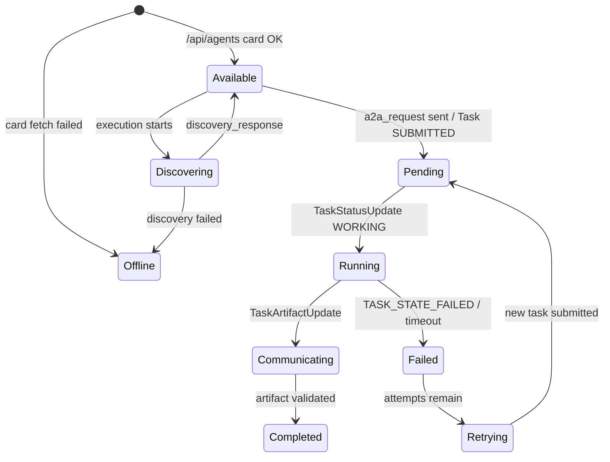

# Event flow

Everything the dashboard displays comes from `ExecutionEvent`s that the Coordinator writes while it actually executes. Nothing on the frontend is timed or simulated. Contract: `backend/shared/events.py`, mirrored in `lib/types.ts`.

## The event

```json
{
  "id": "5b0c…",                       // unique event id
  "seq": 17,                           // strictly increasing per execution; also the SSE id
  "execution_id": "e305…",
  "timestamp": "2026-11-21T00:25:17.845951Z",
  "type": "a2a_task",
  "channel": "a2a",                    // "a2a" = real network traffic, "internal" = orchestration
  "agent_id": "budget",                // sender
  "target_agent_id": "coordinator",    // receiver (null for non-messages)
  "task_id": "859a7244-…",             // remote A2A task id when known
  "status": "pending",                 // when non-null: the NEW status of agent_id
  "message": "Budget Planning Agent accepted task (TASK_STATE_SUBMITTED)",
  "payload": { "task": { … } },        // sanitized protocol message / data
  "metadata": { "message_type": "Task", "task_state": "TASK_STATE_SUBMITTED", "direction": "response" }
}
```

## Event types

| Type | Channel | Emitted when | Typical status change |
|---|---|---|---|
| `execution_started` | internal | Request accepted | coordinator → `running` |
| `orchestration` | internal | Coordinator step ("Delegating … in parallel") | coordinator → `communicating` / `running` |
| `agent_status` | internal | Status bookkeeping (discovering, pending, retrying, completed) | as given |
| `discovery_request` | a2a | Agent Card GET sent | — |
| `discovery_response` | a2a | Card received and validated (payload = card), or failed | specialist → `available` / `offline` |
| `a2a_request` | a2a | `SendStreamingMessage` sent (payload = request, task JSON inlined) | coordinator → `communicating` |
| `a2a_task` | a2a | `Task` received (`SUBMITTED`) | specialist → `pending` |
| `a2a_status_update` | a2a | `TaskStatusUpdateEvent` received | `WORKING` → `running`; terminal states → none |
| `a2a_artifact` | a2a | `TaskArtifactUpdateEvent` received | specialist → `communicating` |
| `a2a_error` | a2a | Attempt failed (failed task, timeout, transport, invalid artifact) | specialist → `failed` |
| `validation` | internal | Artifact validated / failed, consistency checks | — |
| `plan_ready` | internal | Final plan stored | — |
| `execution_completed` / `execution_failed` | internal | Terminal (written atomically with the stored result) | coordinator → `completed` / `failed` |

Metadata keys: `message_type`, `task_state`, `direction`, `endpoint`, `task_label` (the human label of the task), `summary` and `duration_ms` (on a specialist's `completed` status), `attempt`, `artifact_id`, `error`.

## Agent status machine



Frontend rule (`lib/agent-state.ts`): an agent's status is the last non-null `status` among events whose `agent_id` is that agent. Before any event, it is the availability from `/api/agents`.

## SSE protocol

```http
GET /api/executions/{id}/events?token=<access_token>[&last_event_id=<seq>]
Accept: text/event-stream
```

```text
event: execution_event
id: 17
data: {"id":"…","seq":17,…}

: ping                      (every 15 s)

event: end
data: {"status":"completed"}
```

- The server replays every stored event with `seq > cursor`, then waits on a per-execution `asyncio.Condition` for new ones.
- The cursor is the larger of `last_event_id` (query) and the `Last-Event-ID` header (sent automatically by `EventSource` on reconnect).
- The terminal event is committed **in the same transaction** as the execution's final status and result. The stream therefore never ends without it, and a snapshot fetched after `execution_completed` always contains the plan.
- `end` closes the stream; the frontend then fetches `GET /api/executions/{id}` for the `result`.

## Frontend lifecycle (`hooks/useExecution.ts`)

1. `POST /api/plans` returns `{execution_id, access_token}`. These are saved to `sessionStorage`.
2. The hook opens an `EventSource`, de-duplicates events by `seq`, and tracks the highest `seq`.
3. On error it shows **Reconnecting** and reopens with `last_event_id = highest seq`, with backoff.
4. On `end` or a terminal event it fetches the snapshot, which holds the final plan.
5. On page reload it reads `sessionStorage`, fetches the snapshot (all events plus the result), and resumes the stream if the execution is still running.

## Isolation and persistence

- Each execution has its own random token; only its SHA-256 hash is stored. A token for execution A cannot read execution B (`test_security_and_validation`).
- Events are rows in SQLite (`COORDINATOR_DB_PATH`), keyed by `(execution_id, seq)`. Concurrent executions never share in-memory collections.
- When the Coordinator restarts, it marks executions left `running` as failed (*Interrupted*), so their streams end cleanly.
